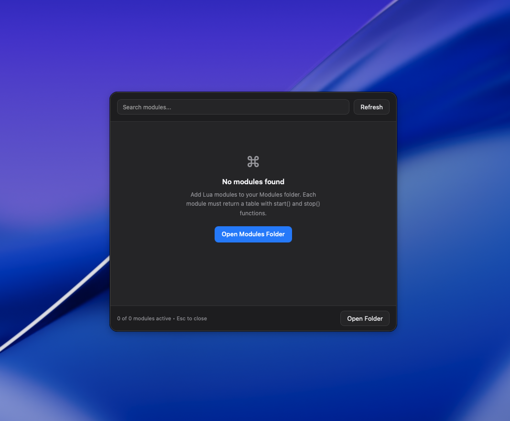

# Hammerspoon Module Manager



A fast, floating module manager for Hammerspoon. It provides a visual interface to dynamically load, enable, and disable custom Lua scripts on the fly without reloading your entire Hammerspoon configuration.

## Installation

### 1. Install Hammerspoon
Before using this manager, you need to have Hammerspoon installed and running on your Mac. You can download it from [hammerspoon.org](https://www.hammerspoon.org/) or install it via Homebrew:
```bash
brew install --cask hammerspoon
```

### 2. Download the Manager
You can install the manager either by cloning the repository or by creating the folder manually. 

**Option A: Clone from Git**
```bash
cd ~/.hammerspoon
git clone --depth 1 --filter=blob:none --sparse https://github.com/hdmi1519/hammerspoon_module_manager.git temp_repo
cd temp_repo
git sparse-checkout set Modules
mv Modules ../Modules
cd ..
rm -rf temp_repo
```

**Option B: Use CURL**
```bash
curl -o ~/.hammerspoon/Modules/module_manager.lua https://raw.githubusercontent.com/hdmi1519/hammerspoon_module_manager/main/Modules/module_manager.lua
```

**Option C: Manual Setup**
1. Create a `Modules` directory inside your Hammerspoon config folder:
   ```bash
   mkdir -p ~/.hammerspoon/Modules
   ```
2. Download or copy `module_manager.lua` and place it directly into the `~/.hammerspoon/Modules/` folder.

### 3. Initialize in Hammerspoon
Open your `~/.hammerspoon/init.lua` file and add the following line:

```lua
require("Modules.module_manager")
```
*Note: You only need to `require` the file. The manager will silently load in the background and bind its hotkey. Calling `.start()` is not needed unless you want the UI window to forcefully pop up every time Hammerspoon restarts.*

### 4. Apply Changes
Reload your Hammerspoon configuration (usually via the menubar icon or `Cmd + Alt + Ctrl + R`).

## Usage

- **Toggle Interface**: Press `Cmd + Alt + M` to open or close the module manager.
- **Close Window**: Press `Esc` while the window is active.
- **Refresh List**: Press `Cmd + R` while the window is focused to discover newly added scripts without restarting Hammerspoon.

## Writing Modules

Modules are standard Lua files placed in the `~/.hammerspoon/Modules/` directory. The manager automatically scans this folder, parses the metadata, and renders the UI.

### Module Structure
Every module must return a Lua table containing at least two functions: `start()` and `stop()`. 

You can optionally provide metadata (`name`, `description`, `version`, `hotkeys`) which will be parsed and displayed in the manager interface. Note that the `hotkeys` field is strictly visual—you still need to bind the actual hotkey via `hs.hotkey.bind` inside your `start()` function.

### Example: Keyboard Cleaner
Create a file named `keyboard_cleaner.lua` inside `~/.hammerspoon/Modules/` and add the following code:

```lua
local M = {
    name = "Keyboard Cleaner",
    description = "Blocks keyboard input for safe cleaning",
    version = "1.0.0",
    hotkeys = {"Cmd", "Ctrl", "Alt", "L"} -- Visual metadata for the UI
}

local lockTap = nil
local hotkey = nil

local function stopLock()
    if lockTap then
        lockTap:stop()
        lockTap = nil
    end
    hs.alert.show("Keyboard Unlocked", 2)
end

local function startLock()
    if lockTap then return end
    
    local types = hs.eventtap.event.types
    lockTap = hs.eventtap.new({types.keyDown, types.keyUp, types.flagsChanged, types.systemDefined}, function(e)
        local flags = e:getFlags()
        
        -- Unlock if Cmd + Alt + Ctrl + L is pressed
        if flags.cmd and flags.alt and flags.ctrl and e:getKeyCode() == 37 then
            if e:getType() == types.keyDown then
                hs.timer.doAfter(0.1, stopLock)
            end
            return true
        end
        return true -- Block all other input
    end)

    lockTap:start()
    hs.alert.show("KEYBOARD LOCKED\nPress Cmd+Opt+Ctrl+L to unlock", {textSize = 24, padding = 30}, "infinite")
end

function M.start()
    -- Register the trigger hotkey when the module is enabled
    hotkey = hs.hotkey.bind({"cmd", "alt", "ctrl"}, "l", function()
        if not lockTap then startLock() end
    end)
    return true
end

function M.stop()
    stopLock()
    if hotkey then
        hotkey:delete()
        hotkey = nil
    end
    return true
end

return M
```

### Module API Reference

| Field / Function | Type | Required | Description |
| :--- | :--- | :--- | :--- |
| `name` | `string` | No | Display name of the module. Defaults to the raw filename if omitted. |
| `description` | `string` | No | Short description shown beneath the title in the UI. |
| `version` | `string` | No | Version string (e.g., `"1.0.0"`). |
| `hotkeys` | `table` | No | Array of strings representing the shortcut (e.g., `{"Cmd", "Opt", "C"}`). Used purely for displaying visual keystroke badges. |
| `start()` | `function` | **Yes** | Called when the module is toggled ON. Initialize your hotkeys, event taps, and watchers here. Must return `true` or `false`. |
| `stop()` | `function` | **Yes** | Called when the module is toggled OFF. You **must** destroy/stop any active hotkeys, event taps, or timers here to prevent memory leaks. Must return `true` or `false`. |
